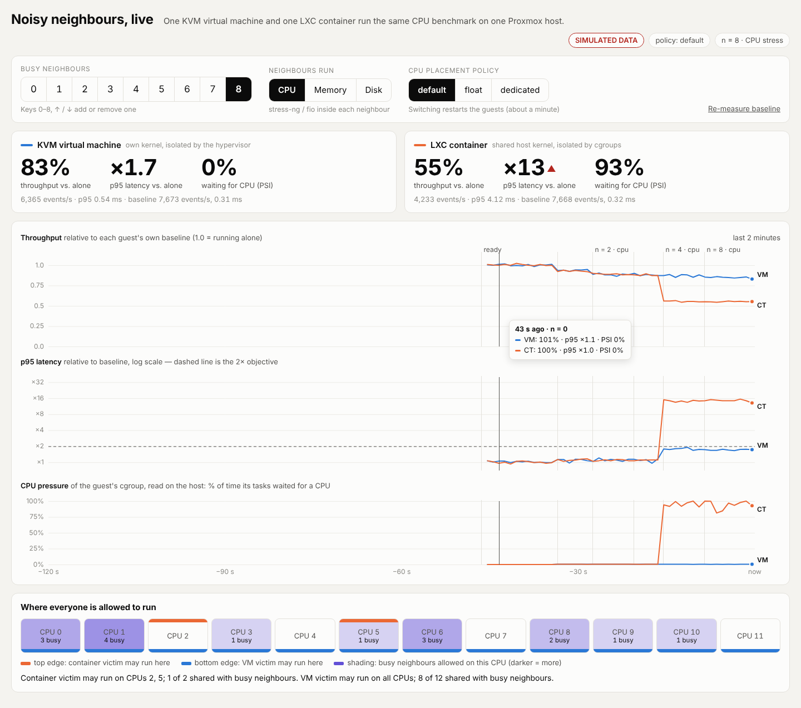
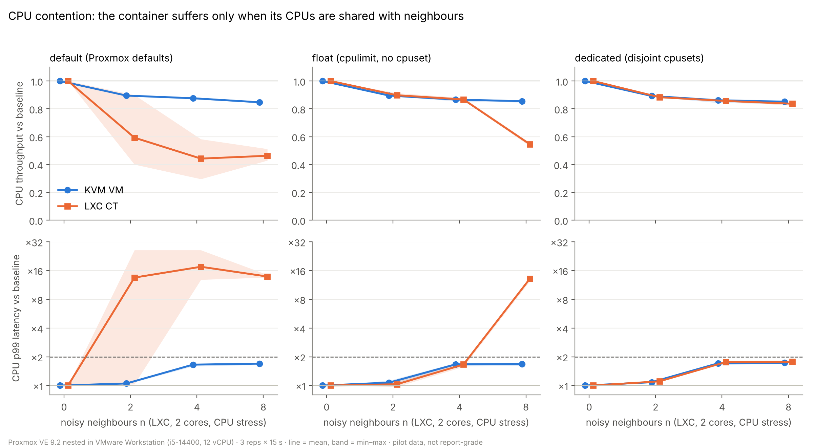
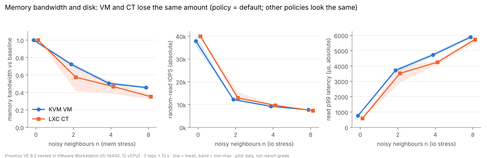
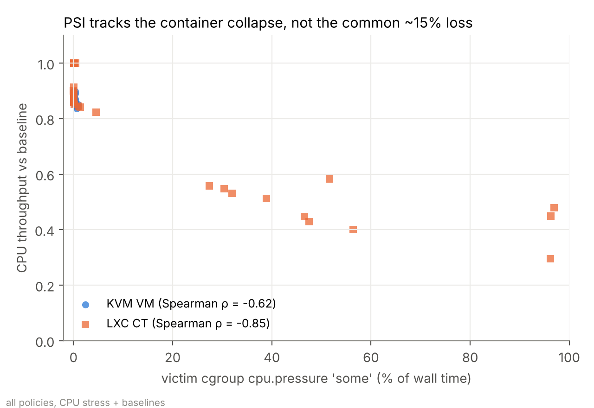

# Noisy Neighbours on Proxmox VE: Performance Isolation of KVM VMs and LXC Containers

Operating Systems term project, National Chung Cheng University, Fall 2026 (two-person team).

We repeat the *competing-workload interference* experiment of Sharma et al. (Middleware 2016) on a current
Proxmox VE stack (kernel 7.0, cgroup v2): one measured guest (a KVM VM or an LXC container) runs next to
n noisy-neighbour LXC containers, and we measure how much its CPU, memory and disk performance degrade.
Slowdowns are explained with host-side kernel counters (cgroup v2 PSI) instead of only being reported.

> **Status (2026-11-11): pilot data only.** All results in this repository come from Proxmox VE running
> *inside VMware Workstation* (nested virtualisation). They are useful for the method and for CPU
> placement effects, but the VM arm carries an extra virtualisation layer and disk results are dominated
> by the VMware virtual disk. Report-grade data needs a bare-metal Proxmox host (planned).

> **Plan (2026-11-12): the same matrix is being repeated on a second machine** so that the two result
> sets can be compared. See [Run on another machine and compare](#run-on-another-machine-and-compare).

## Run on another machine and compare

The measurement protocol must stay identical to the pilot (same script, same defaults: 3 repetitions,
n = 2, 4, 8, three policies), otherwise the two result sets cannot be compared. Do not change
`REPS`, `BT`, `NLIST`, `STRESSES` or `POLICIES` for this run.

**Requirements.** Proxmox VE 9.x, at least 6 CPUs (the pilot had 12), about 12 GB RAM and 100 GB of free
guest storage, internet access from the host, and 10 free addresses in the host's subnet
(`.60`, `.61`, `.71`–`.78`; the script refuses an address that answers a ping). The script only creates and
touches VMIDs 9100, 9101 and 9111–9118 and refuses to run if those IDs belong to something else.

```bash
# on the Proxmox host, as root
apt-get update && apt-get install -y git
git clone <this repository's URL> /root/os-noisy-neighbours && cd /root/os-noisy-neighbours

ls /dev/kvm                      # must exist, otherwise the VM cannot run (see below)
bash osproj.sh all               # builds the guests, runs a short preflight, then the matrix in the background
bash osproj.sh status            # progress; the run survives a closed terminal and resumes with 'all'

bash osproj.sh export <label>    # when 198 configurations are done: copies the run to results/<label>-<date>/
git add results && git commit -m "Results: <label>" && git push
```

The full matrix takes several hours (the pilot needed most of a night). Keep the machine otherwise idle.

### 第二台機器也是 VMware 裡的 Proxmox（注意事項）

**這次比較能驗證什麼、不能驗證什麼。** 兩台機器都多了一層 VMware，所以第二次量測回答的是
「換一台機器能不能重現」，不是「拿掉巢狀虛擬化之後結論還在不在」。

- 能確認的是**機制**：容器只有在 CPU 和忙碌的鄰居重疊時才掉速、`float` 下的差距來自 cgroup 階層、
  記憶體頻寬和磁碟對兩種 guest 都沒有隔離。
- 不能確認 Proxmox 以下各層的影響，例如「任何 policy 都消不掉的約 15% 損失來自 VMware 排程、SMT 或
  turbo」這個說法。這仍然需要裸機。

**安裝之前，先把 VMware 裡那台 Proxmox VM 設成和 pilot 一樣：**

| VMware 設定 | Pilot | 第二台機器 |
|---|---|---|
| Processors（vCPU 數） | 12 | 12；電腦的硬體執行緒不夠就設少一點，並記下實際數字 |
| Memory | 16 GB | 16 GB |
| 「Virtualize Intel VT-x/EPT or AMD-V/RVI」 | 開 | 開 |
| 主機 Windows 的 hypervisor | 關 | 關：執行 `tools\switch-hypervisor.bat`，選 Proxmox，重開機 |
| Network adapter | NAT | NAT 或橋接都可以，但該網段要有 10 個空 IP |

**三個常見問題**

1. **`/dev/kvm` 不存在。** Windows hypervisor 還在執行（WSL 2、Docker Desktop、Windows Sandbox、
   「記憶體完整性」都會讓它保持開啟），VMware 就無法把 VT-x 傳給 Proxmox。`osproj.sh all` 會立刻停下
   並顯示這個訊息，不會白跑幾個小時。關掉 hypervisor、重開 Windows，再到 Proxmox 裡執行
   `ls /dev/kvm` 確認。
2. **vCPU 數超過電腦的硬體執行緒數。** 這樣 VMware 自己就過載了，它的排程會污染所有數字。到
   工作管理員 › 效能 › CPU 看「邏輯處理器」的數量，vCPU 不要超過它；留兩個執行緒給 Windows 更好。
3. **主機 CPU 有 P-core 和 E-core**（Intel 第 12 代以後）。在 VMware 裡所有 vCPU 看起來都一樣，
   Proxmox 和這個腳本都無法得知某個 vCPU 跑在哪種核心上，guest 裡也沒有任何辦法控制。請把主機的
   CPU 型號寫進比較結果，並列為限制。

**比較時要另外記錄的資訊**（`export` 隔著 VMware 讀不到）：主機的 CPU 型號、核心數與執行緒數、
給 Proxmox VM 的 vCPU 數與記憶體、VMware Workstation 版本、虛擬磁碟放在 SSD 還是傳統硬碟。

**Things that differ between machines — check before the long run**

| Check | Why | What to do |
|---|---|---|
| `/dev/kvm` exists | no hardware virtualisation means no VM arm | bare metal: enable VT-x / AMD-V in the BIOS. Nested in VMware on Windows: enable "Virtualize Intel VT-x/EPT" for the VM and turn the Windows hypervisor off — `tools/switch-hypervisor.bat` (WSL 2 and Docker Desktop need it on, so it is one or the other) |
| storage name | the script uses `local-lvm`; a ZFS install has `local-zfs` | `STORE=local-zfs bash osproj.sh all` |
| P- and E-cores (Intel 12th gen or newer, bare metal) | `dedicated` puts the victim on the last two CPUs, which are E-cores on hybrid CPUs | the script prints a warning; pick two P-cores that are not SMT siblings from `lscpu -e` and run e.g. `DED=0,2 SHARED=4-15 bash osproj.sh all` |
| number of CPUs | with other than 12 CPUs the oversubscription points move (the pilot oversubscribes only at n = 8: 18 threads on 12 CPUs) | nothing to change, but state it when comparing; `NCPU`, `DED` and `SHARED` are recorded |
| demo auto-start | the live-demo service keeps the victims busy | must be off: `bash demo/install-autostart.sh --remove` |

`export` also writes `platform.txt` (bare metal or virtualised, CPU model and topology, max frequency per CPU,
governor, SMT, disks) so that the comparison can state exactly what differed.

**Compare** (on any machine with Python 3, no extra packages):

```bash
python3 analysis/compare.py results/nested-2026-10-19 results/<label>-<date> -o results/compare.md
python3 analysis/plot.py results/<label>-<date>     # same three figures for the new run (needs pandas, scipy, matplotlib)
```

`compare.py` prints the two platforms, the uncontended baselines in absolute numbers, the headline numbers
behind each pilot finding side by side, the baseline drift, and every configuration where the two machines
differ by more than 0.10 of baseline. Absolute numbers are expected to differ; what matters is whether the
*relative* pattern of each finding survives.

## Project status (2026-11-12)

| Area | State | Notes |
|---|---|---|
| Proposal (2-page abstract, Sep 29) | ✅ done | questions: baseline, isolation under contention, density n* |
| Experiment harness (`osproj.sh`) | ✅ done | builds guests, resumable matrix, only touches its own VMIDs |
| Pilot matrix on nested Proxmox | ✅ done (Oct 19) | 198 configurations, no missing values — `results/nested-2026-10-19/` |
| Pilot analysis + figures | ✅ done | `analysis/`, findings below |
| Live demo | ✅ built, ⚠️ not yet rehearsed on the host | `demo/` — tested in simulation mode only |
| Second-machine run | ⏳ prepared, not run | same matrix on another host, then `analysis/compare.py`; a bare-metal host is still needed for report-grade numbers and for the VM-vs-CT disk question |
| n = 1 level, p95 metric, 5 repetitions | ❌ | without them n* can only be bounded ("< 2"), not interpolated |
| Throttling (`cpu.stat`), `io.stat`, VM steal time | ❌ not recorded | the proposal asks which of throttling / pressure / steal explains each slowdown |
| cgroup-hierarchy hypothesis (finding 2) | ❌ not verified | `cat /sys/fs/cgroup/{qemu.slice,lxc}/cpu.weight` + a control run |
| Comparison table with Sharma et al. 2016 | ❌ | |
| Final report (15 pages, Dec 29) | ❌ not started | |

Deviations from the proposal, to be stated in the report: Debian instead of Ubuntu in the guests, 16 GB instead
of 20 GB disks, the two victims run one at a time, p99 instead of p95 in the pilot, n ∈ {0, 2, 4, 8} and 3
repetitions instead of n ∈ {0, 1, 2, 4, 8} and 5, and three CPU placement policies plus a memory-bandwidth
stress were added.

## Repository layout

```
osproj.sh                      experiment harness used for all results here (bash, runs on the Proxmox host)
results/nested-2026-10-19/     raw.csv (long format), summary.csv, placement.tsv (CPU placement log), meta.txt (platform + guest configs)
results/<label>-<date>/        runs from other machines, written by `osproj.sh export` (adds platform.txt)
analysis/                      load.py + plot.py -> fig1_cpu.png, fig2_mem_io.png, fig3_psi.png
                               compare.py -> side-by-side comparison of two result sets (standard library only)
tools/                         switch-hypervisor.bat: Windows hypervisor on/off (WSL 2 vs nested Proxmox in VMware)
demo/                          live demo: web page with neighbour / stress / policy controls (see demo/README.md)
tooling/os-isolation/          alternative Python harness (randomised blocks, 1 Hz sampler, report generator);
                               tested in simulation only, not used for the results above
```

## Experiment (results/nested-2026-10-19)

| Factor | Levels |
|---|---|
| Measured guest | KVM VM (Debian 13 cloud image, 2 vCPU, 2 GB, `cache=none,iothread=1`) · LXC CT (Debian, 2 cores, 2 GB, unprivileged) |
| Neighbours | n = 0, 2, 4, 8 LXC containers (2 cores, 1 GB each) |
| Neighbour stress | CPU (`stress-ng --cpu`), memory bandwidth (`stress-ng --stream`), disk (`fio` 4k randrw QD32 direct) |
| CPU placement policy | `default` (Proxmox defaults) · `float` (`cpulimit`, no cpuset) · `dedicated` (victim and neighbours on disjoint cpusets) |
| Victim benchmarks (15 s each) | `sysbench cpu` (events/s, p99), `sysbench memory` (MiB/s), `fio` 4k randread QD16 direct (IOPS, p99), 1 ms sleep wake-up latency |
| Repetitions | 3, policy order rotated per repetition, stress configurations shuffled, baseline before and drift check after each block |

Host: Proxmox VE 9.2.2 on 12 vCPUs / 16 GB, nested in VMware Workstation 17 on an Intel i5-14400 (Windows 11).

Run it (on the Proxmox host, as root): `bash osproj.sh all` · `bash osproj.sh status` · `bash osproj.sh summary` ·
`bash osproj.sh export [label]` · `bash osproj.sh policy <default|float|dedicated>` ·
`bash osproj.sh clean` (destroys only the project's own guests, VMIDs 9100, 9101, 9111–9118, after checking their names).

Reproduce the figures: `pip install pandas numpy scipy matplotlib && python3 analysis/plot.py`

## Live demo

The demo shows, live, the main pilot finding: under Proxmox defaults a container slows down sharply once
busy neighbours land on its CPUs, while the VM barely moves, and the difference disappears when CPUs are
assigned explicitly. Full details: [demo/README.md](demo/README.md).



**Setup used in the talk.** The desktop that hosts VMware + Proxmox is operated through Chrome Remote Desktop.
The demo page is opened in a browser *on that desktop* (the VMware NAT network is only reachable from there),
so the audience sees the remote screen. One-time setup on the Proxmox host:
`bash <repo>/demo/install-autostart.sh`.

**Before the talk (start 10 minutes early)**

| Time | Step | What you should see |
|---|---|---|
| T−10 min | On the desktop, double-click `demo\start-demo.bat` | a console window: VM powering on, then the Proxmox IP |
| T−7 min | the browser opens `http://<proxmox-ip>:8080/` by itself | yellow banner "Starting guests and benchmarks…" |
| T−5 min | banner disappears | both tiles at ~100 %, policy chip shows the current policy |
| T−5 min | if the policy is not `default`, click **default** and wait (~1–2 min) | guests restart, tiles return to ~100 % |
| T−2 min | look at the CPU map: which two CPUs does the container have? | orange top edge on two CPUs |
| T−1 min | close the console window of `start-demo.bat`; leave only the browser in full screen (F11) | |

**On stage (about 4 minutes)**

| Step | Action | What the audience sees | Say |
|---|---|---|---|
| 1 | nothing (n = 0) | both guests at 100 %, PSI 0 % | same CPU benchmark in a VM and in a container; numbers are relative to each one running alone |
| 2 | point at the CPU map | container confined to 2 CPUs (orange), VM allowed on all 12 (blue) | Proxmox gives each container a fixed 2-CPU cpuset by default |
| 3 | press `↑` one at a time up to 4, wait ~10 s after each | purple shading spreads over the CPUs; within 2–4 s of a neighbour landing on an orange CPU the container drops and its p95 crosses the dashed 2× line, CPU pressure jumps | the container is not slower, it is *waiting*: PSI measures that from the host |
| 4 | press `8` | container at roughly 40–60 %, p95 above 10×; VM stays at 85–90 % | in the pilot data this happened in every repetition at n = 8 |
| 5 (optional, +2 min) | press `0`, click **dedicated**, talk over the ~1–2 min restart, then press `8` | both curves together at ~85 % | the gap came from CPU placement, not from the virtualisation technology; the remaining ~15 % is shared hardware that no policy removes |
| end | press `0` | both back to ~100 % | |

Notes: every key press needs 2–4 s before the curves move (neighbour start-up + 1 s sampling + 1 s page
refresh), so pause after each step. Under `default` the CPUs Proxmox gives the container change at every
start, so the n at which it collapses in step 3 varies; step 4 (n = 8) is the reliable one. Keys: `0`–`8`,
`↑`/`↓`; the browser tab must have focus (click once on the page after switching windows in the remote
desktop). Finish with `demo\stop-demo.bat`, and after the talk turn auto-start off:
`bash <repo>/demo/install-autostart.sh --remove`.

## Pilot findings (nested platform, 3 repetitions)



1. **CPU: the container degrades only when its CPUs overlap with busy neighbours.** Under Proxmox defaults
   the container's cpuset overlapped with active neighbours in most runs: CPU throughput fell to 0.44–0.59 of
   baseline and p99 latency rose 13–17×, while the VM stayed at 0.85–0.90. With disjoint cpusets
   (`dedicated`) the two curves coincide.
2. **Open question: VM advantage from the cgroup hierarchy?** With no pinning (`float`) the container still
   collapses at n = 8 (0.55, p99 13×) while the VM does not (0.86). Hypothesis: the VM sits alone under
   `qemu.slice`, while the measured container shares `lxc/` with all eight neighbours. Not yet verified.
3. **A ~15 % loss no placement policy removes** (also with disjoint CPUs), invisible to PSI: likely frequency
   scaling, SMT sharing or host scheduling of the nested vCPUs.
4. **Memory bandwidth and disk are not isolated for either guest type.** Under disk stress both converge to
   the same absolute performance (~7.2k IOPS, p99 ~5.9 ms at n = 8); the larger *relative* drop of the
   container comes from its higher baseline, not from worse isolation.
5. **Attribution:** victim-cgroup CPU PSI tracks the container's CPU slowdown (Spearman ρ = −0.85); I/O PSI
   is not comparable across guest types (asynchronous libaio waits are not counted for the container).




## Remaining work (in order)

1. Extend `osproj.sh`: add n = 1, record p95 next to p99, read `cpu.stat` (throttling), `io.stat` and the VM's steal time per run.
2. Verify the cgroup-hierarchy hypothesis (finding 2).
3. Repeat the unchanged matrix on a second machine and compare (`analysis/compare.py`); then re-run on a
   bare-metal Proxmox host with more repetitions (`default` policy at least).
4. Analysis: slowdown curves, n* with an interval, attribution, VM-vs-CT tests, comparison with Sharma et al. (2016).
5. Final report (15 pages), stating each member's role.

## References

1. W. Felter, A. Ferreira, R. Rajamony, J. Rubio. *An Updated Performance Comparison of Virtual Machines and Linux Containers.* IEEE ISPASS 2015.
2. P. Sharma, L. Chaufournier, P. Shenoy, Y. C. Tay. *Containers and Virtual Machines at Scale: A Comparative Study.* Middleware 2016.
3. Linux kernel documentation, *Control Group v2* and *PSI — Pressure Stall Information*.
4. Proxmox VE Administration Guide.
